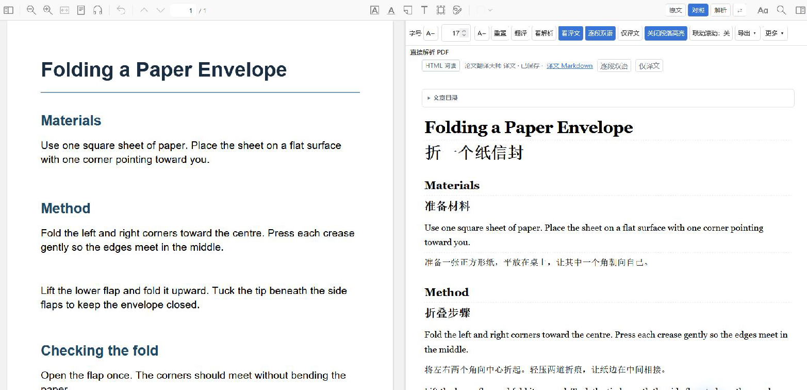

# 论文翻译大师 · Paper Translation Master

简体中文 · [English](docs/languages/en.md) · [日本語](docs/languages/ja.md) · [Español](docs/languages/es.md) · [Français](docs/languages/fr.md) · [Deutsch](docs/languages/de.md)

在 Zotero 里并排读论文原文和译文。选中段落可以回到 PDF，发现图注错位可以移回图下，记不清论文标题时可以用中文描述找回读过的段落。识别结果与译文保存为 Zotero 附件，下次打开可直接阅读。

**当前推荐版本为 0.8.2。** Windows 和 Apple 芯片 Mac 使用同一套阅读、批注、编辑和检索功能。升级时请同时安装对应平台的运行环境和包内 XPI。

| 平台 | 完整安装包 | 解压后运行 |
| --- | --- | --- |
| Windows 10／11 x64 | [下载 Windows 版](https://github.com/XvHaoR/paper-translation-master/releases/download/v0.8.2/paper-translation-master-windows-x64-0.8.2.zip) | `Install.cmd` |
| macOS 14 及以上，Apple 芯片（M 系列） | [下载 macOS 版](https://github.com/XvHaoR/paper-translation-master/releases/download/v0.8.2/paper-translation-master-macos-arm64-0.8.2.zip) | `Install.command` |

支持 Zotero 7–10。关闭 Zotero，把 ZIP 解压到长期保留的目录，运行上表中的安装文件。重新打开 Zotero，在「工具 → 插件 → 齿轮 → 从文件安装」选择同目录的 XPI。[图文使用教程](docs/TUTORIAL.md) · [macOS 安装说明](docs/MACOS.md) · [发布说明和 SHA-256 校验值](https://github.com/XvHaoR/paper-translation-master/releases/tag/v0.8.2)



## 选择 PDF 处理方式

| 论文和设备 | 在设置中选择 | 准备工作 |
| --- | --- | --- |
| 能选中文字的 PDF | 直接解析 PDF | 完整包自带解析环境，离线可用 |
| 扫描件，本机运行模型 | 本地 OCR | 连接已安装的 PaddleOCR 或 RapidOCR；也可配置兼容的本机服务 |
| 扫描件，使用云端 | 飞桨云端 OCR 或 MinerU 官方云端 | 申请对应服务的令牌。识别时会上传选中的 PDF。[飞桨令牌](https://aistudio.baidu.com/account/accessToken) · [MinerU 令牌](https://mineru.net/apiManage/token) |
| 自己运行了 MinerU | MinerU 自部署 | 填写服务地址，有鉴权时填写该服务的密钥 |

Windows 提供两种可选的本地引擎。PaddleOCR-VL GPU 安装器需要 NVIDIA 独显，至少 8 GB 显存，推荐 12 GB；RapidOCR 使用 CPU，建议至少 8 GB 内存和 5 GB 可用磁盘。Apple 芯片 Mac 可直接使用包内解析和离线检索，做本地 OCR 时需另接兼容的引擎或服务。[Windows GPU 安装器](https://github.com/XvHaoR/paper-translation-master/releases/download/v0.5.0/paper-translation-master-setup-0.5.0.exe) · [Windows CPU 安装器](https://github.com/XvHaoR/paper-translation-master/releases/download/v0.5.0/paper-translation-master-rapidocr-setup-0.5.0.exe) · [完整部署要求](docs/INSTALLATION.md)

## 0.8.2 可以做什么

- **读与批注**。在同一标签页切换原 PDF、对照和解析视图。逐段双语或仅译文按论文保存。能定位的外文原文选区可写成 Zotero 原生 PDF 高亮和批注；译文选区的批注留在译文中。
- **校正排版**。拖动识别块调整顺序，改正文、摘要、图注或表注的类型，删除多余子图。已有译文跟随顺序、删除和类别变化。改动文字后可以只补译受影响的段落。
- **后台识别和翻译**。右键一篇文献可直接识别、翻译全文和标题，或连续执行两项。批量窗口可勾选多篇。翻译使用自己配置的兼容接口，Temperature 留空时使用模型默认值。
- **按内容找论文**。识别后自动建索引。可以用中文输入记得的线索，查看候选论文、命中片段和原文位置。完整包附带多语种 CPU 检索模型，也支持嵌入 API。
- **管理本地 OCR**。默认方案设为「本地 OCR」后，工具栏提供预热与关闭。最后一篇任务完成后默认空闲 5 分钟释放模型，等待时间可调。已有结果仍可阅读、翻译和导出。
- **带走结果**。可导出 HTML、Markdown 和结构化 Excel 表格。识别为 LaTeX 的公式可以直接复制。

[分步图文教程](docs/TUTORIAL.md) · [识别方案与高级配置](docs/UNIFIED_EDITION.md) · [升级已有文库](docs/MIGRATION.md) · [更新记录](CHANGELOG.md)

开发版的批量窗口支持按添加时间排序和按处理状态筛选。设置分为「翻译服务」「文献处理」「阅读外观」。[开发版更新记录](CHANGELOG.md#未发布)

## 开发与许可

```bash
python -m pip install -e ".[dev,layout,semantic]"
npm ci --prefix tests/dom
python -m pytest tests/unit tests/integration -q
python packaging/build_release.py
```

原创代码采用 AGPL-3.0-or-later。第三方模型及依赖使用各自的许可证。[构建与发布](docs/RELEASING.md) · [许可证](LICENSE) · [第三方声明](THIRD_PARTY_NOTICES.md)
