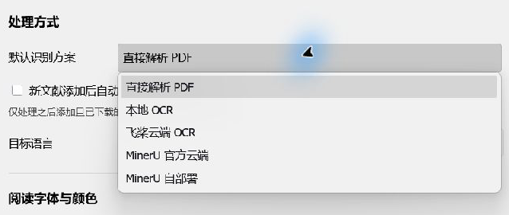
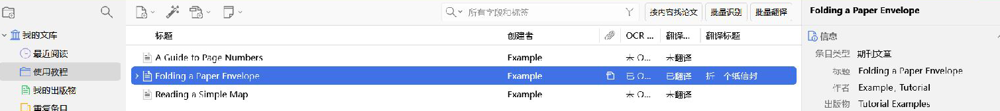
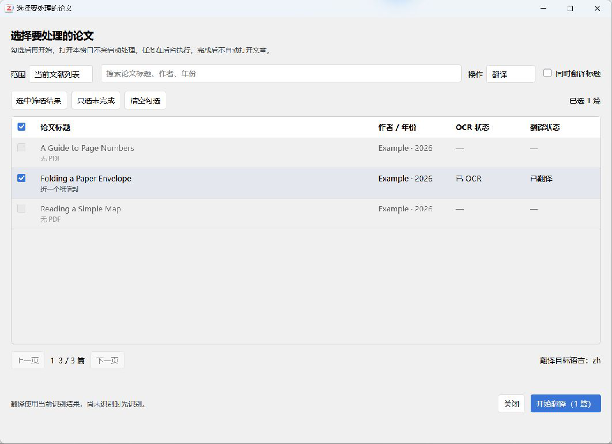
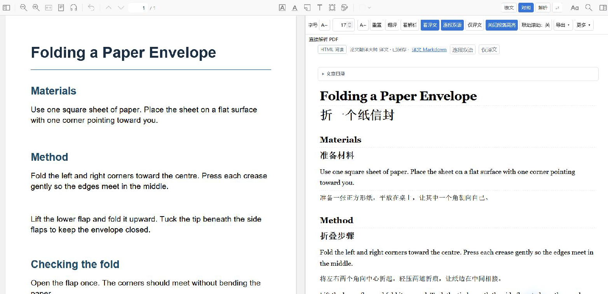
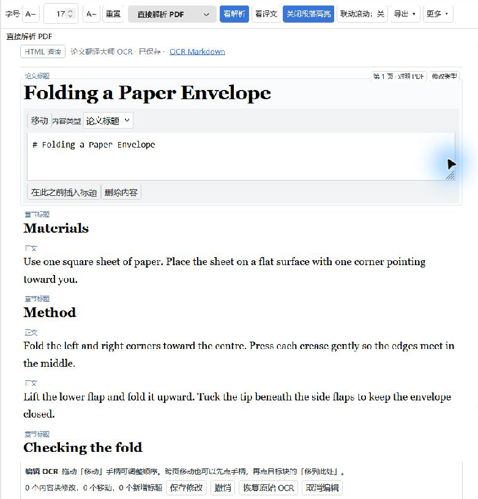
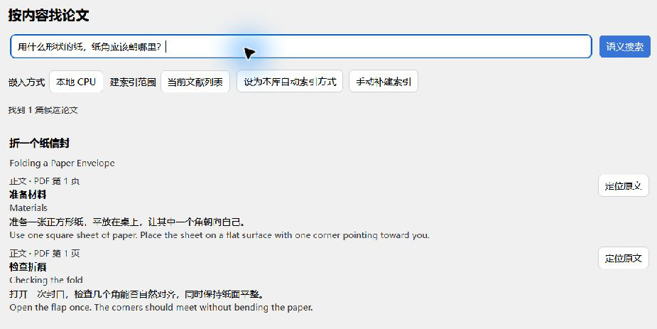

# 在 Zotero 里识别、翻译和找回论文

[下载 0.8.2](https://github.com/XvHaoR/paper-translation-master/releases/tag/v0.8.2) · [English quick start](languages/en.md) · [其他语言介绍](../README.md)

本教程使用独立的 Zotero 演示文库。示例文档《Folding a Paper Envelope》以及配对的中文译文专为教程编写。截图来自 Windows 版 Zotero 10，Apple 芯片 Mac 使用同一套插件控件。

## 1. 安装并选择识别方案

1. 退出 Zotero，解压适合电脑的完整 ZIP。Windows x64 运行 `Install.cmd`。Apple 芯片 Mac 在 macOS 14 或更新版本运行 `Install.command`。[Windows 下载](https://github.com/XvHaoR/paper-translation-master/releases/download/v0.8.2/paper-translation-master-windows-x64-0.8.2.zip) · [macOS 下载](https://github.com/XvHaoR/paper-translation-master/releases/download/v0.8.2/paper-translation-master-macos-arm64-0.8.2.zip)
2. 打开 Zotero，在「工具 → 插件」（部分版本为「附加组件」）的齿轮菜单中选「从文件安装」，选择刚解压的 XPI，再重启 Zotero。升级也需运行新版安装脚本。
3. 打开「工具 → 论文翻译大师 → 设置」。PDF 中可以划选文字时，先用「直接解析 PDF」。扫描件可选已部署的本地 OCR、飞桨、MinerU 官方云端或自己的 MinerU 服务。选好默认方案和目标语言后点「保存设置」。

本地 OCR 需要单独配置引擎。默认选择它时，工具栏会显示「预热本地 OCR」。可以提前加载，也可以直接提交论文。批量队列最后一篇完成后默认空闲 5 分钟释放资源，设置范围为 1–120 分钟。独立启动的外部服务由其启动程序管理。[本地部署](INSTALLATION.md) · [各服务的地址和令牌](UNIFIED_EDITION.md)

## 2. 处理一篇或多篇论文

在文献库右键点论文，进入「论文翻译大师」。选「OCR 当前论文」先阅读识别结果，选「OCR 并翻译当前论文（含标题）」可一次完成两步。已有结果时，选「翻译当前论文（含标题）」即可复用。只需要中文题名时可选「仅翻译当前标题」。

翻译前，在设置的「翻译服务」填写兼容接口地址、准确的模型 ID 和服务所需的密钥，保存并测试连接。Temperature 可以留空。选择本地模型时，先启动提供该接口的服务。识别 PDF 和翻译文字分别使用所选的服务。

点击文献列表上方的「批量识别」或「批量翻译」，勾选要处理的论文。可筛选文献、切换操作，也可在批量翻译时勾选「同时翻译标题」。点击右下角开始后，任务在后台运行。图中缺少 PDF 的两个示例条目显示为灰色。

## 3. 对照阅读与批注

打开文献的 PDF，点阅读器右上角的「对照」。在右侧选「看解析」或「看译文」。点「逐段双语」可看到每段原文和译文，点「仅译文」可专心阅读译文。这个选择按论文记忆。窄窗口会将部分操作收进「更多」菜单。

点右侧段落可定位 PDF。需要标记时，划选右侧文字，再点「高亮」或「批注」。能匹配到 PDF 文字的外文原文选区会生成 Zotero 原生批注；在译文上划选时，标记保存在该译文中。图表和扫描页的定位精度取决于识别结果提供的坐标。

## 4. 把识别错误改回来

在「看解析」里打开「编辑解析」（OCR 页面中也可能显示「编辑 OCR」）。选中块后，可改文字、更换内容类型或删除多余的图片。要把跑到文末的图注移回图下，拖动「移动」手柄，或先点手柄、再点目标块的「移到此处」。将类型设为图注，点「保存修改」。

移动、删除和更改类型会同步调整已有译文的排版。修改了原文措辞时，保存后可选择只重译受影响的段落。「导出」可保存阅读用 HTML 或 Markdown。有结构的表格可导出 Excel，带 LaTeX 的公式可直接复制。

## 5. 只记得内容时找回论文

点文献列表上方的「按内容找论文」，输入自己记得的线索，然后点「语义搜索」。首次使用可选「本地 CPU」；完整包自带多语种模型。新识别的文章自动加入本库索引，已有文献可用「手动补建索引」。

点候选论文的「打开 PDF」，或点命中片段旁的「定位原文」。中英对照优先使用已保存的译文，缺少中文时可由配置的翻译服务补译。选择嵌入 API 会将用于索引或检索的文本发往该服务。[返回项目首页](../README.md)
