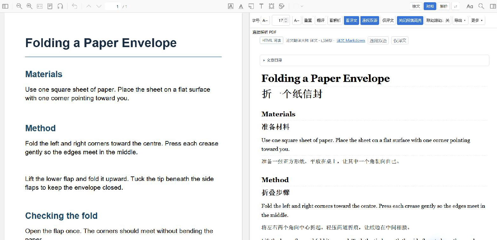

# Paper Translation Master for Zotero

[简体中文](../../README.md) · [English](en.md) · [日本語](ja.md) · [Español](es.md) · [Français](fr.md) · [Deutsch](de.md)

Read a PDF alongside an editable transcript or a translation. Select a passage to return to its place in the PDF. If you remember a detail but have forgotten the title, search your library with a description and open the matching passage.

## Install version 0.8.2

1. Download the full package for your computer. The Mac package requires an Apple silicon Mac with macOS 14 or later. Both packages support Zotero 7–10. [Windows x64](https://github.com/XvHaoR/paper-translation-master/releases/download/v0.8.2/paper-translation-master-windows-x64-0.8.2.zip) · [macOS arm64](https://github.com/XvHaoR/paper-translation-master/releases/download/v0.8.2/paper-translation-master-macos-arm64-0.8.2.zip)
2. Quit Zotero and unzip the package into a folder you intend to keep. Run `Install.cmd` on Windows or `Install.command` on macOS.
3. In Zotero, open **Tools → Plugins**, use the gear menu to install the XPI from that folder, then restart. When upgrading, update both the runtime and the XPI.

## Read your first paper

Right-click a paper and open **论文翻译大师**. Choose **OCR 当前论文** to recognize it. For a PDF with selectable text, the default parser runs locally. For a scan, choose a local OCR engine, PaddleOCR cloud, MinerU cloud or a self-hosted MinerU service. Cloud recognition uploads the selected PDF. For translation, enter your model and compatible endpoint in the plugin settings.

**对照** opens the side-by-side reader. **逐段双语** pairs paragraphs and **仅译文** shows the translation. A highlight on matched source text can become a native Zotero PDF annotation. A highlight on a translation stays with that translation. The full bundle includes an offline multilingual search model. [Illustrated guide with Chinese interface labels](../TUTORIAL.md)

